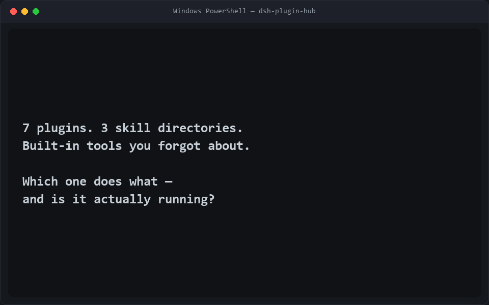
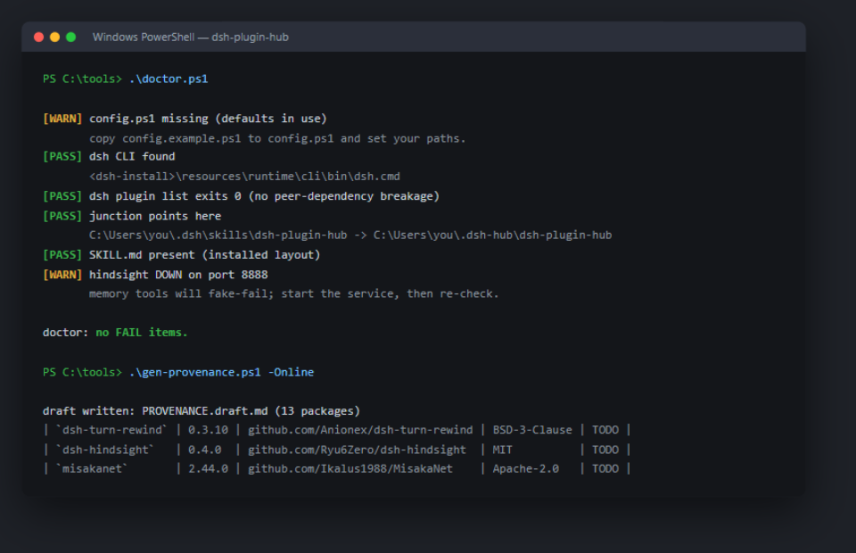

# dsh-plugin-hub

[](https://github.com/Charles950311/dsh-plugin-hub/actions/workflows/test.yml)

**One control hub for every plugin and skill installed in DeepSeek Harness (dsh).**

<p align="center"></p>

DeepSeek Harness ships a deliberately barebones core — "everything is a plugin".
Within weeks its community produced turn rewind, long-term memory, skill cards,
failure-experience libraries, Obsidian bridges, browser automation, local
transcription, security scanners... and then you face the real problem:

> You have 7 plugins across profile bundles, a skills directory, and built-in
> tools. You can't remember which one does what, whether it's actually running,
> or what you installed last week.

`dsh-plugin-hub` is the missing front door:

- **One routing table** (`SKILL.md`) — the agent answers "which tool for X" from a
  single, maintained table instead of guessing across plugin lists.
- **One status command** (`status.ps1`) — profile plugins, tool files, services,
  and skill junctions, checked in one shot.
- **One install step** (`install.ps1`) — copies the hub and junctions it into
  `%USERPROFILE%\.dsh\skills` so DSH hot-loads it. Skills stay in one unified
  directory; no more copy-pasting folders into `.dsh`.
- **One manifest** (`PROVENANCE.md`) — what you installed, from where, which
  license, verified how. The routing table is only allowed to claim what this
  file confirms.
- **Safety rules baked in** — third-party skills are untrusted by default; scan
  before install; no safety-policy-bypassing or account-pool plugins.

## Two ways to run it

**1. As a dsh bundle (recommended).** The repo is an installable DeepSeek
Harness bundle: `package.json` declares `dsh.bundle`, and `cordis.patch.yml`
registers the plugin. Installing it adds three tools to the session:

```powershell
dsh plugin --profile desktop add https://github.com/Charles950311/dsh-plugin-hub
```

| Tool | Answers |
| --- | --- |
| `hub_plugins` | what is installed in this profile, which version, and whether each bundle is actually present on disk |
| `hub_check` | PASS/WARN/FAIL per check — profile manifest, third-party bundles on disk, skills directory, local services — each with a fix hint |
| `hub_route` | "which plugin handles X", from a maintained routing table, including whether that plugin is installed |

All three are read-only: nothing is installed, removed or patched. Platform
bundles (`@deepseek-ai/*`) are reported as `BUILTIN` — they ship inside the
harness, so a missing `node_modules` copy is normal, not a fault.

The npm name is `dsh-control-hub` (`dsh-plugin-hub` was already taken on npm);
the GitHub repo keeps the original name.

**2. As a skill + CLI scripts.** The original layout still works and needs no
Node: `install.ps1` copies the hub skill and junctions it into
`%USERPROFILE%\.dsh\skills`; `status.ps1` / `doctor.ps1` /
`gen-provenance.ps1` run outside the harness. See Quick start below.

## Quick start (skill + scripts, Windows, PowerShell 5.1+)

```powershell
git clone https://github.com/<you>/dsh-plugin-hub.git
cd dsh-plugin-hub
powershell -ExecutionPolicy Bypass -File .\install.ps1
# then edit %USERPROFILE%\.dsh-hub\dsh-plugin-hub\config.ps1
```

Restart DSH (or reload its Web UI) and ask your agent:

```
Which plugins are installed, and which one handles long-term memory?
```

## Health checks

`status.ps1` gives you the inventory; `doctor.ps1` gives you a verdict per check
with a fix hint, and `-Fix` applies the safe repairs (UTF-8 BOM, missing
junction):

<p align="center"></p>

```
[PASS] config.ps1 present, UTF-8 BOM ok
[PASS] junction points here
[WARN] hindsight DOWN on port 8888
       memory tools will fake-fail; start the service, then re-check.
```

That WARN is the point: a loaded plugin is not a running service, and the hub
says so instead of letting a call fake-succeed.

## Compatibility

| dsh version | Status |
| --- | --- |
| 0.2.0-rc.2 (Desktop) | tested — hub in production use |
| 0.2.1-rc.2 (Desktop) | tested — incl. turn-rewind 0.3.10 compat fixes |
| 0.2.1-rc.3 (CLI `headless`) | tested — bundle installs, activates, and a real session's model calls `hub_check` and reports its values |

Windows-first (junctions, PowerShell). PRs for other platforms welcome.

## What it does NOT do

- It is not a plugin manager (`dsh plugin add/remove` still does that) — it is
  the discovery, dispatch, and truth-keeping layer above your plugins.
- It does not collect or send anything anywhere. All paths come from your local
  `config.ps1`, which is git-ignored.

## Roadmap

- [x] Installable bundle: `dsh.bundle` + `cordis.patch.yml` contributing `hub_plugins`, `hub_check`, `hub_route` (read-only)
- [x] 30-second demo GIF (`docs/demo.gif` — rendered from a sandbox run by
  `docs/make-demo-gif.py`; profile prefix shown as `C:\Users\you`)
- [x] `doctor` mode: per-check PASS/WARN/FAIL with fix hints (`doctor.ps1`, `-Fix` applies safe repairs)
- [x] Provenance generator: auto-draft the manifest from `dsh plugin list` (`gen-provenance.ps1`, `-Online` enriches via npm)
- [ ] Community routing-table presets (security, media, office workflows)

## More from TaintLens Studio

This hub grew out of a production single-operator studio running security-audit
and skills-factory pipelines. If you find it useful:

- **Security services** (code audit, SRC report review): <https://Charles950311.github.io/taintlens-studio/>
- **Agent skills & toolkits** (TaintLens Code Audit, Local Transcribe Toolkit, Browser Pilot): see the studio page
- Open an issue here for hub questions — PRs for new routing-table presets are welcome.

## Related projects

The hub routes to community plugins — the table above is only an entry point.
Notable ecosystem projects: [Anionex/dsh-turn-rewind](https://github.com/Anionex/dsh-turn-rewind),
[Ikalus1988/MisakaNet](https://github.com/Ikalus1988/MisakaNet),
[Ryu6Zero/dsh-hindsight](https://github.com/Ryu6Zero/dsh-hindsight),
[mingzeng21/dsh-obsidian](https://github.com/mingzeng21/dsh-obsidian),
[vercel-labs/agent-browser](https://github.com/vercel-labs/agent-browser),
[cisco-ai-defense/skill-scanner](https://github.com/cisco-ai-defense/skill-scanner).

---

Need a hardened multi-machine setup (skills factory, CI gating, security audit
pipelines) built on this pattern? Open an issue or reach out — this repo grew
out of a production single-operator studio.

MIT licensed. Provided as-is; review every third-party plugin you install.
